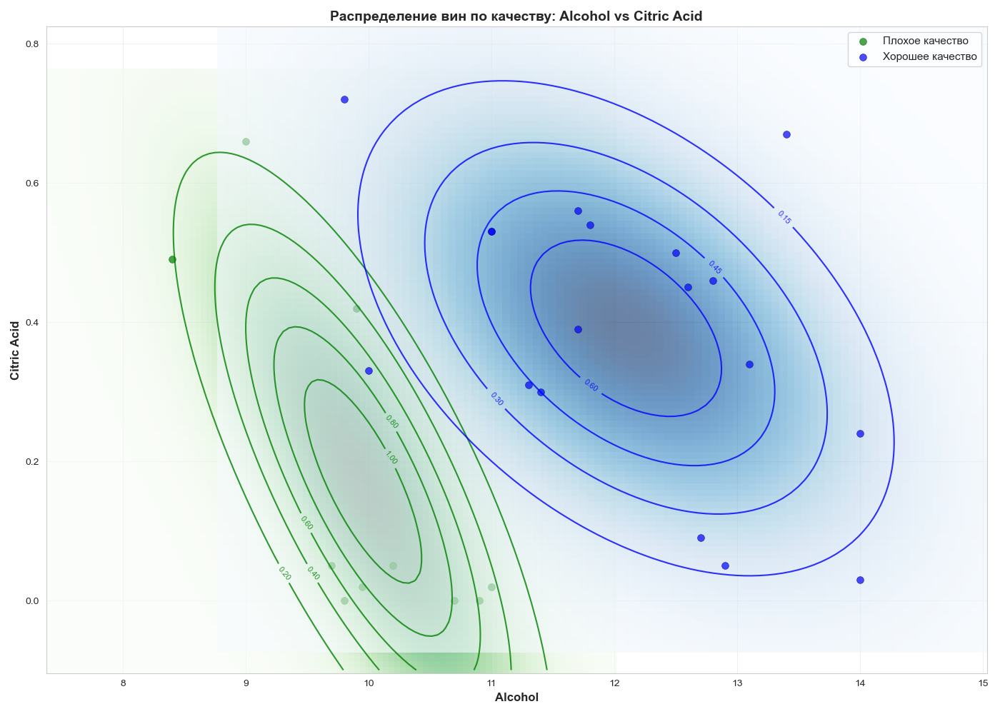

# EDA винного датасета: Анализ факторов, влияющих на качество вина 🍷

*Учебный проект в рамках программы профессиональной переподготовки «Аналитик данных» (НИУ ВШЭ), 2025–2026.*

## 📌 О проекте

Данный проект выполнен в рамках домашнего задания по курсу «Прикладная статистика» программы переподготовки НИУ ВШЭ. Задача — провести разведочный анализ данных (EDA) на основе классического датасета **Wine Quality** (красное вино): изучить распределения признаков, выдвинуть и проверить гипотезы, а также визуализировать взаимосвязи между химическими показателями и оценкой качества вина.

## 📌 Цель проекта

Отработать практические навыки анализа реальных данных с помощью Python:
- **категоризация и группировка** данных на основе непрерывных признаков;
- **вычисление описательных статистик** (среднее, медиана, диапазон) по группам;
- **поиск и анализ выбросов** с помощью межквартильного размаха (IQR);
- **визуализация** — построение boxplot и scatterplot с наложением двумерной плотности вероятности;
- **формулировка и проверка гипотез** о влиянии химического состава на качество вина.

---

## 📁 Данные

- **Источник:** учебный датасет `winequality-red.csv` (классический UCI Machine Learning Repository)
- **Размер:** 1 599 строк, 12 признаков
- **Признаки:** `fixed acidity`, `volatile acidity`, `citric acid`, `residual sugar`, `chlorides`, `free sulfur dioxide`, `total sulfur dioxide`, `density`, `pH`, `sulphates`, `alcohol`
- **Целевая переменная:** `quality` (оценка качества от 3 до 8)

---

## 🎯 Задание 1 — Категоризация по содержанию алкоголя

### 📊 Что сделано
Вина разделены на три категории по объёмной доле алкоголя, добавлена колонка `category`:
- `low alcohol` — $x \le 10$
- `medium alcohol` — $10 < x \le 12$
- `high alcohol` — $x > 12$

### 📈 Результат
| Категория | Количество вин |
|-----------|----------------|
| low alcohol | 747 |
| medium alcohol | 711 |
| high alcohol | 141 |

---

## 🎯 Задание 2 — Статистики содержания остаточного сахара по категориям

### 📊 Что сделано
Для каждой категории алкоголя рассчитаны среднее и медиана содержания остаточного сахара (`residual sugar`).

### 📈 Результат
| Категория | Mean | Median |
|-----------|------|--------|
| high alcohol | 2.76 | 2.3 |
| medium alcohol | 2.59 | 2.2 |
| low alcohol | 2.45 | 2.1 |

Дополнительно рассчитан диапазон (`range = max - min`):
| Категория | Min | Max | Range |
|-----------|-----|-----|-------|
| low alcohol | 1.2 | 15.5 | 14.3 |
| medium alcohol | 1.2 | 13.9 | 12.7 |
| high alcohol | 0.9 | 8.3 | 7.4 |

### 🧠 Вывод
Распределение остаточного сахара зависит от крепости алкоголя. Среднее и медиана сахара прямо пропорциональны крепости. При этом **разброс** (диапазон) сахара значительно шире у слабоалкогольных вин — их распределение более нестабильно.

---

## 🎯 Задание 3 — Boxplot остаточного сахара по категориям

### 📊 Что сделано
Построен `boxplot` с помощью `seaborn` для визуализации распределения остаточного сахара в разрезе трёх категорий алкоголя. Использована палитра `viridis`, добавлено отображение средних значений (`showmeans=True`).

### 📈 Результат
- На графике чётко видны **правосторонние выбросы** (высокие значения сахара).
- **Среднее смещено вправо** относительно медианы, что подтверждает наличие выбросов в сторону больших значений.
- Для оценивания содержания сахара **лучше использовать медиану**, так как она устойчива к выбросам (в отличие от среднего).

---

## 🎯 Задание 4 — Анализ выбросов

### 📊 Что сделано
Поиск выбросов выполнен по правилу **1.5 × IQR** (межквартильный размах), так как на boxplot видно множество выбросов и смещение среднего.

### 📈 Результаты
| Категория | Q1 | Q3 | IQR | Границы выбросов | Кол-во выбросов |
|-----------|----|----|-----|------------------|-----------------|
| low alcohol | 1.8 | 2.5 | 0.7 | [0.75, 3.55] | 54 |
| medium alcohol | 2.0 | 2.6 | 0.6 | [1.1, 3.5] | 84 |
| high alcohol | 2.0 | 2.9 | 0.9 | [0.65, 4.25] | 18 |

**Всего выбросов:** 156 из 1599 записей (≈ 9.8%).

### 🧠 Вывод
Количество выбросов велико во всех категориях, со смещением в сторону **большего** содержания сахара. Это подтверждает необходимость использования устойчивых к выбросам метрик (медианы) для анализа.

---

## 🎯 Задание 5 — Сравнение очень хороших и очень плохих вин

### 📊 Что сделано

**1. Scatterplot** для вин с `quality == 3` (плохие) и `quality == 8` (хорошие) по признакам `alcohol` и `citric acid`. Использована палитра из двух крайних цветов `viridis`.

**2. Оценка параметров многомерного нормального распределения** для каждой из выборок:
- Рассчитаны векторы средних и ковариационные матрицы.
- Построены графики плотности с помощью `sps.multivariate_normal.pdf`.

**3. Визуализация плотности:**
- Использован `plt.pcolormesh` с градиентной заливкой (`Greens` для плохого вина, `Blues` для хорошего).
- Добавлены линии контура (`plt.contour`) с подписями значений (`plt.clabel`).
- Нанесены точки выборок: зелёные для плохого вина, синие для хорошего.
- Добавлены подписи осей и легенда.

### 📈 Ключевые результаты

| Показатель | Плохое вино (quality=3) | Хорошее вино (quality=8) |
|------------|--------------------------|---------------------------|
| Кол-во образцов | 10 | 18 |
| Средний алкоголь | 9.96 | 12.09 |
| Средняя лимонная кислота | 0.17 | 0.39 |

> 📷 **График распределения вин по качеству:**  
>   
> *(График сохранён в папке `images/`)*

### 🧠 Вывод
Сомелье отдают предпочтение **более крепким винам** со **средней кислотностью**. Напротив, слабые вина с низкой кислотностью получают наименьшие оценки.

---

## 🔧 Инструменты и стек

- **Язык:** Python 3.13
- **Обработка данных:** `pandas`, `numpy`
- **Визуализация:** `matplotlib.pyplot`, `seaborn`
- **Многомерная статистика:** `scipy.stats.multivariate_normal`
- **Среда:** Jupyter Notebook

## 📊 Итоги проекта

| Задача | Подход | Ключевой результат |
|--------|--------|--------------------|
| Категоризация | `apply` + `value_counts` | 3 категории, 141–747 вин в каждой |
| Описательные статистики | `groupby` + `agg` | Mean и median сахара растут с крепостью |
| Boxplot | `seaborn.boxplot` | Визуализация выбросов и смещения среднего |
| Анализ выбросов | 1.5 × IQR | 156 выбросов, смещение вправо |
| Сравнение вин | `multivariate_normal` + `pcolormesh` | Крепкие вина с средней кислотностью — лучше |

## 🧠 Отработанные концепции

- **Группировка и агрегация:** `groupby`, `agg`, кастомные функции.
- **Описательные статистики:** среднее, медиана, диапазон, межквартильный размах (IQR).
- **Выбросы:** правило 1.5 × IQR, визуальная диагностика на boxplot.
- **Многомерное нормальное распределение:** оценка параметров (`mean`, `cov`) и визуализация плотности.
- **Визуализация плотности:** `pcolormesh`, контурные линии, наложение точек.
- **Интерпретация:** связь между химическим составом вина и его оценкой сомелье.

## 📁 Структура репозитория

```
eda_wine_quality/
├── README.md
├── notebooks/
│ └── stat_HW_2.ipynb
├── data/
│ └── winequality-red.csv
├── images/
│ └── alcohol_vs_citric_acid.png
└── requirements.txt
```


## 📝 Статус

✅ Проект завершён
